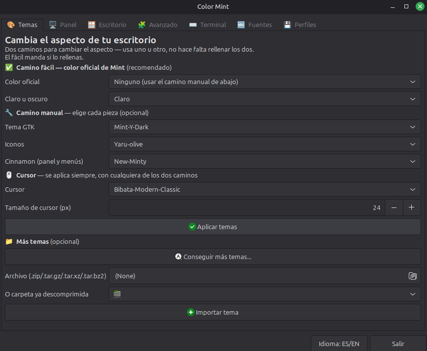
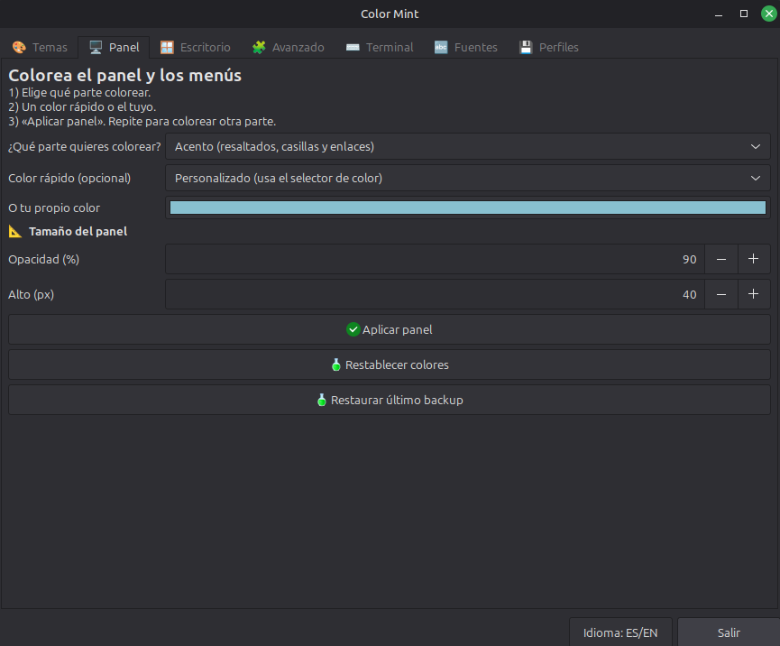
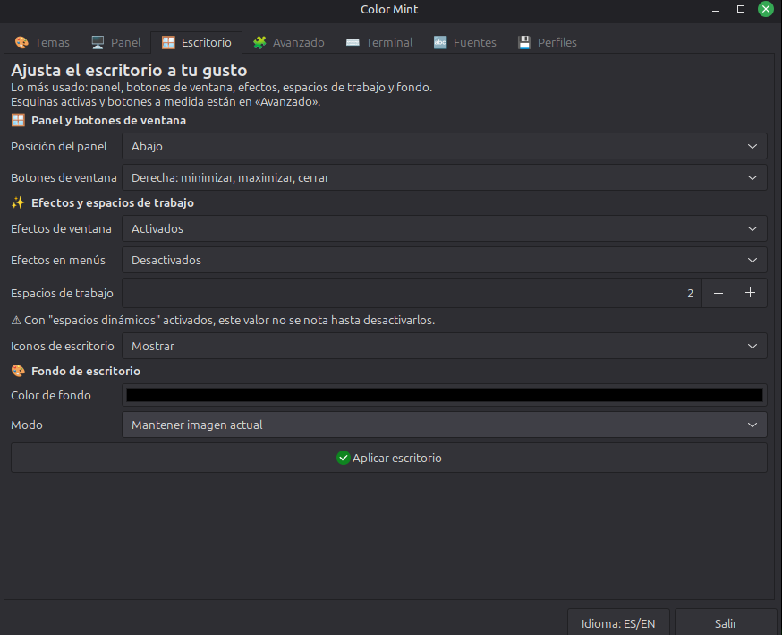
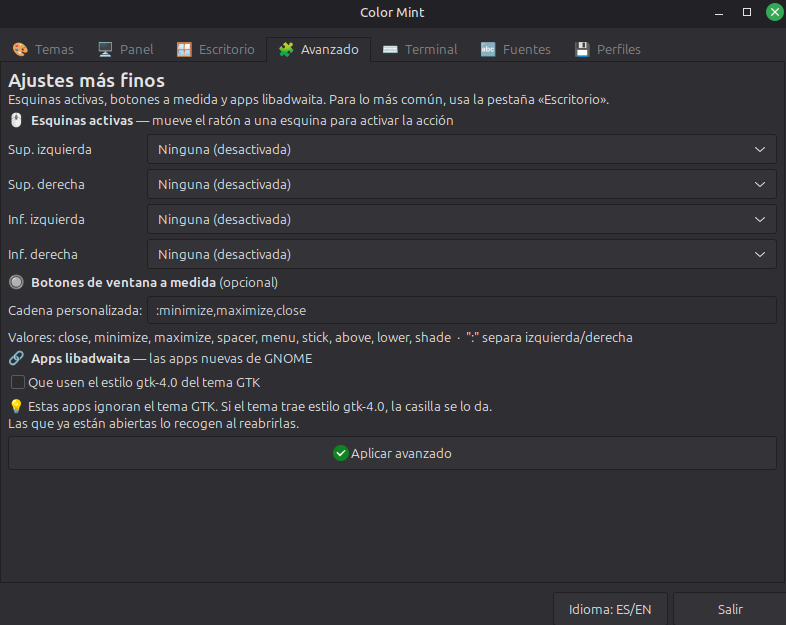
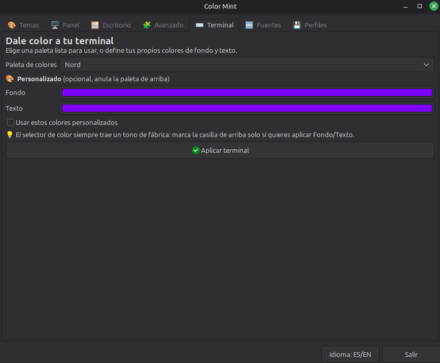
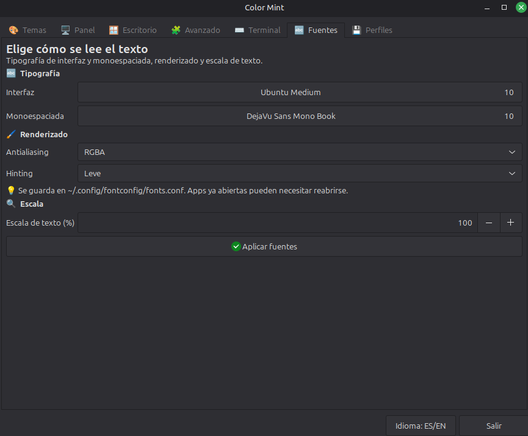
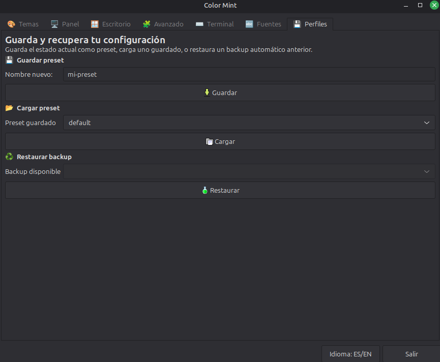

<p align="center">
  
</p>

# Color Mint

[English](README.md)

 [](https://www.gnu.org/software/bash/) [](https://linuxmint.com/) [](LICENSE.txt)

Personalización estética de Linux Mint Cinnamon en una sola ventana: temas, panel, escritorio, terminal y fuentes — con copia de seguridad automática antes de cada «Aplicar» de la ventana.

> **Idioma:** Color Mint incluye toda su interfaz en español y en inglés. Detecta el idioma del sistema automáticamente (español si procede, inglés en cualquier otro caso), y puedes cambiarlo al instante con el botón **Idioma: ES/EN** o con `./color-mint.sh l`. Esta es la versión en español; el inglés es el idioma principal de la documentación.

## Novedades de la versión 3.1.0

- **Instalar y desinstalar sin dejar rastro.** `./color-mint.sh install` añade Color Mint al menú de aplicaciones (una copia en `~/.local/bin/color-mint` y un lanzador con su icono; sin `sudo`). `uninstall` quita solo lo que Color Mint puede demostrar que es suyo, y `--restore-look` devuelve además el aspecto que tenía tu escritorio antes del primer cambio de Color Mint. Mira [Desinstalación](#desinstalación).
- **Más temas sin salir de la ventana.** El botón **Conseguir más temas...** y `theme fetch <nombre>` descargan un tema de [Cinnamon Spices](https://cinnamon-spices.linuxmint.com) (solo HTTPS, con tope de tamaño, sin sobrescribir nunca un tema que ya tengas). `theme list-packages` y `theme install <paquete>` ofrecen una lista corta y verificada de paquetes de temas (Arc, Materia, Papirus, Bibata...).
- **Apps libadwaita con el estilo de tu tema.** Las apps libadwaita (las apps nuevas de GNOME) ignoran el tema GTK. `theme libadwaita on` y la casilla de la pestaña **Avanzado** les hacen usar el estilo `gtk-4.0` de tu tema GTK, en su variante clara u oscura según el esquema claro/oscuro, y Color Mint lo mantiene al día cuando cambias el tema o el esquema o cargas un look. Tu acento sigue mandando sobre el del tema allí donde el tema pide sus colores por nombre; lo que un tema pinta con colores fijos, como hacen Materia y Mint-Y con sus botones, sigue siendo del tema. `theme libadwaita off` quita el estilo. Las apps que ya están abiertas lo recogen al reabrirlas; un tema que lleva su estilo `gtk-4.0` empaquetado dentro, como Yaru, no se puede importar y se rechaza diciendo por qué.
- **Veinte looks listos y presets que se pueden compartir.** Con los paquetes oficiales de Mint instalados, Color Mint crea un look claro y otro oscuro por cada color de Mint-Y. `preset export` y `preset import` pasan un preset de mano en mano como un archivo normal, y los presets ahora recuerdan el esquema claro/oscuro.
- **Un preset es un dato, nunca código.** Antes los presets se ejecutaban como shell. Ahora se leen como texto plano, solo se aceptan claves conocidas y el preset entero se comprueba antes de aplicar un solo ajuste: un tema que falta o un valor erróneo no cambia nada, y se listan todos los problemas.
- **Importaciones de temas más seguras.** Los archivos se comprueban antes de descomprimirlos (rutas que se salen de la carpeta, enlaces, archivos especiales) y otra vez después. Uno que ocupe más de 512 MB descomprimido o tenga más de 20 000 archivos se rechaza. Los nombres de tema y de fuente con rutas o caracteres de control se rechazan.
- **Escrituras atómicas.** Cada archivo que escribe Color Mint se reemplaza de forma atómica, así que una escritura interrumpida no puede dejar un archivo a medias; las copias de seguridad y los temas importados aparecen de golpe o no aparecen. Dos procesos de Color Mint nunca escriben a la vez.
- **Solo aplica lo que existe.** Los comandos de tema (GTK, iconos, cursor, Cinnamon) ahora rechazan un nombre que no esté instalado, en vez de decir «aplicado» y dejar el escritorio con su aspecto por defecto. También se encuentran los temas instalados en `~/.local/share` o `/usr/local/share`, no solo los de `~/.themes`, `~/.icons` y `/usr/share`.
- **Una ventana más cómoda.** Cabe en una pantalla de 1366×768 (los formularios se desplazan), arranca con cualquier locale (con `LANG=C` antes salía sin mostrar nada), elige el color de texto más legible sobre tu acento, sigue el tema GTK del sistema y ya no deja procesos sueltos al cambiar de idioma o recargar la ventana.
- **Otras distribuciones con Cinnamon.** Con `dnf`, `pacman` o `zypper`, una dependencia que falta viene ahora con el comando exacto que ejecutar (con `apt`, Color Mint sigue ofreciéndose a instalarla); la interfaz gráfica se niega a arrancar en un escritorio que no sea Cinnamon; y la ventana funciona igual con yad 0.40 y 14.1. Un workflow opcional comprueba Debian 13, Fedora y Arch. Mira [Compatibilidad](#compatibilidad).
- **Icono nuevo y un `--help` y un `--version` más discretos.** El icono va dentro del script, así que una copia suelta del script lo conserva. `--version` imprime `Color Mint 3.1.0`, y ni este ni `--help` (ahora dentro de 80 columnas en los dos idiomas) crean carpetas ni escriben ningún estado.
- **Probado.** El repositorio tiene una batería de pruebas (`bash tests/run.sh`, 14 suites que nunca tocan tu escritorio) y un workflow de calidad: ShellCheck 0.11.0 fijado por versión y suma de comprobación, un dibujo real de la ventana bajo Xvfb y un cuadro de mando estético de 13 métricas. Mira [Pruebas](#pruebas).

## Capturas















## Qué es

Cinnamon reparte su apariencia entre el panel de Ajustes, `dconf-editor` y comandos sueltos de `gsettings` — y hay cosas que ni siquiera están ahí: color de acento del panel, paletas de color para el terminal, un acento para tus apps GTK3 y libadwaita. Encima, las claves que hay que tocar viven bajo esquemas poco obvios (`org.cinnamon.desktop.interface` para casi todo, pero `org.gnome.desktop.interface` para la fuente monoespaciada, por poner un ejemplo real) que hay que conocer de memoria o adivinar.

Color Mint junta todo eso —temas, panel, escritorio, terminal y fuentes— en una sola ventana, o en una sola línea de comandos si prefieres la terminal. Ya sabe qué esquema toca en cada caso, y la ventana guarda una copia de seguridad antes de cada «Aplicar».

Por dentro es un único script de Bash. Lee y escribe ajustes con `gsettings`, `dconf` y `gdbus`, dibuja su ventana con `yad` y edita un puñado de archivos de tu carpeta personal (el acento en `gtk.css`, el renderizado de las fuentes en `fonts.conf`...) solo cuando usas el comando correspondiente. No hay ningún servicio ni demonio en segundo plano.

Siete bloques, tanto en la interfaz gráfica como en la terminal:

- **🎨 Temas** — tema GTK, iconos, cursor (con su tamaño) y tema de Cinnamon. Un camino rápido con los colores oficiales del paquete Mint-Y, o pieza por pieza si prefieres mezclar temas de terceros. También importa temas descargados en `.zip`, `.tar.gz`, `.tar.xz` o `.tar.bz2`, listos para aplicar, y, desde el botón **Conseguir más temas...** o desde la terminal, puede traer un tema de Cinnamon Spices por su nombre o instalar un paquete de una lista corta y verificada de paquetes de temas.
- **🖥️ Panel** — color de acento, fondo y texto del panel, fondo y texto de los menús, fondo y texto de los tooltips, opacidad y alto. Incluye un acento GTK que llega a las apps GTK3 y libadwaita que abras después, no solo al panel.
- **🪟 Escritorio** — posición del panel, botones de ventana (7 presets o una cadena a medida), efectos al abrir/cerrar ventanas y menús, número de espacios de trabajo, iconos del escritorio y color de fondo.
- **🧩 Avanzado** — las cuatro esquinas activas (hot corners), los botones de ventana con cadena personalizada y una casilla para que las apps libadwaita usen el estilo `gtk-4.0` de tu tema GTK, separado de «Escritorio» para no llenarla de campos.
- **⌨️ Terminal** — nueve paletas de color listas para el perfil por defecto de gnome-terminal, o colores de fondo/texto a medida.
- **🔤 Fuentes** — fuente de la interfaz, fuente monoespaciada, antialiasing + hinting y escala del texto.
- **💾 Perfiles** — guarda el estado actual como preset con nombre, carga uno guardado (vienen dos de ejemplo y, con los paquetes oficiales de Mint, veinte looks), o restaura cualquier copia de seguridad anterior.

Cada una de estas acciones tiene su comando de terminal equivalente — la referencia completa está en [Comandos](#comandos).

## Ventajas

- **Una ventana, el esquema correcto siempre.** Cambiar el acento del panel, aplicar una paleta al terminal, o llevar un acento a tus apps GTK3 y libadwaita normalmente implica abrir `dconf-editor`, adivinar el esquema correcto (que cambia según el ajuste, como se explica arriba) y, en el caso del acento, editar a mano el CSS del tema activo. Color Mint ya sabe todo eso — los comentarios técnicos al principio del script documentan, esquema por esquema, cómo se averiguó cada uno, por si te sirven de referencia el día que quieras tocar algo que se sale de aquí.
- **Cada «Aplicar» de la ventana se puede deshacer.** Antes de que cada botón «Aplicar» cambie nada, la ventana crea una copia de seguridad automáticamente, así que puedes probar sin miedo a dejar el escritorio peor de como estaba: si algo no convence, la pestaña «Perfiles» lo restaura en un clic. Los comandos de terminal no hacen copia por su cuenta; ejecuta antes `backup create`. Qué guarda una copia y qué quita al restaurar se explica en [Backups y presets](#-backups-y-presets).
- **Un acento sobre cualquier tema de Cinnamon.** El acento de color no se limita al paquete oficial Mint-Y: funciona sobre cualquier tema de Cinnamon que tengas instalado, detectando su color dominante y sustituyéndolo por el que elijas.
- **Un acento más allá del panel.** Ese mismo acento también se puede fijar para las apps GTK3 y libadwaita (apps GTK4 al estilo GNOME), no solo para el panel. Solo lo muestran las apps que abras después, y no se espera que lo reciban por defecto las apps Flatpak ni las GTK2.
- **Un tema que llega a las apps libadwaita.** Las apps libadwaita ignoran el tema GTK que eliges. Color Mint puede hacer que carguen su estilo `gtk-4.0` y lo mantiene al día cuando cambian el tema o el esquema claro/oscuro, con tu acento por encima donde el tema lo permite.
- **Construido sobre lo que ya hizo la comunidad.** No hay un formato de tema nuevo que aprender: Color Mint usa los temas GTK, de iconos, de cursor y de Cinnamon que ya tienes, importa los que descargues y trae más de Cinnamon Spices o de una lista corta de paquetes verificados.
- **Automatizable y compartible.** Cada acción de la interfaz gráfica tiene un comando de terminal equivalente, así que todo esto se puede automatizar. Un preset guardado es un archivo de texto plano que se puede versionar, copiar a otra máquina o editar a mano, y Color Mint nunca lo ejecuta.
- **Un único script autocontenido.** Es un único archivo `.sh` —antes vivía repartido en `gui/`, `lib/` y `presets/`— sin más dependencia real que `yad`, y esa solo hace falta para la interfaz gráfica. El icono es el último bloque del archivo (base64 dentro de comentarios, nunca se ejecuta), así que una copia suelta del script está completa.
- **Cuidadoso con tu sistema.** No pide `sudo` para hacer su trabajo: solo instala un paquete cuando aceptas (porque falta una dependencia, o con `theme install`), y solo se copia a tu carpeta personal cuando ejecutas `install`.
- **Se desinstala sin dejar rastro.** Quita lo que puede demostrar que es suyo, nombra lo que deja y puede devolver el escritorio exactamente a como estaba antes de su primer cambio. Mira [Desinstalación](#desinstalación).

## Compatibilidad

Color Mint necesita una sesión de **Cinnamon** en marcha: depende de los esquemas `org.cinnamon.*` de dconf. En cualquier otro escritorio (GNOME, KDE, Xfce, MATE...) la interfaz gráfica se niega a arrancar y no cambia nada. La línea de comandos no comprueba el escritorio: úsala solo dentro de Cinnamon.

| Entorno | Estado | Notas |
| --- | --- | --- |
| Linux Mint 22.3 Cinnamon | ✅ Probado | Probado en su base Ubuntu 24.04 con yad 0.40.0, incluidos el dibujo real de la interfaz y un clic real en Aplicar. |
| Otras versiones 22.x de Linux Mint y LMDE | 🟡 Esperado | Mismos esquemas de Cinnamon y paquetes de `apt`; sin probar. |
| Otras distribuciones con Cinnamon (Ubuntu Cinnamon, Debian, Fedora, Arch...) | 🟡 Esperado, mejor esfuerzo | Solo `apt` instala por ti las dependencias que falten; con cualquier otro gestor de paquetes, Color Mint muestra el comando exacto que ejecutar. |
| Linux Mint 27 "Adrien" | ❔ Sin verificar | Aún no se ha publicado (prevista para Navidad de 2026, sobre Ubuntu 26.04). Se espera que su Cinnamon admita las sesiones X11 y Wayland; las partes que dependen de X11 podrían necesitar cambios. |
| GNOME, KDE, Xfce, MATE y otros escritorios | ⛔ No compatible | La interfaz gráfica se niega a arrancar. |

- **Bash:** 4.4 o superior; probado en la 4.4.20 y en la 5.2, la versión de Mint 22.3.
- **yad:** probado con la 0.40.0 (Mint 22.x, Ubuntu 24.04) y con la 14.1, el fork actual; la ventana y los botones Aplicar se comportan igual.
- **Privilegios:** no hace falta `sudo` para usarlo. Solo lo pide `theme install` (a través de `apt`), y solo después de que aceptes.

Herramientas que usa:

| Herramienta | Para qué | ¿Viene de fábrica en Mint 22.3? |
| --- | --- | --- |
| `dconf`, `gsettings`, `gdbus` | Leer y escribir todos los ajustes | Sí |
| `yad` | Interfaz gráfica | No — Color Mint se ofrece a instalarlo |
| `notify-send` | Notificación de escritorio al aplicar cambios | Sí (opcional) |

## Instalación

Clonar y ejecutar; no hace falta instalar nada para usarlo:

```bash
git clone https://github.com/filonux/Color-Mint.git
cd Color-Mint/script
chmod +x color-mint.sh
./color-mint.sh
```

También funciona con `bash color-mint.sh`, sin darle antes permisos de ejecución (el propio script se los añade él solo si puede), o descargando únicamente `script/color-mint.sh` y abriéndolo con doble clic desde el gestor de archivos.

Para tenerlo en el menú de aplicaciones, incluso después de borrar el clon, instálalo para tu usuario:

```bash
./color-mint.sh install
```

Copia el script en `~/.local/bin/color-mint` y crea un lanzador con su icono; no necesita `sudo` y nunca sobrescribe un archivo que no sea suyo. Una vez instalado, `color-mint` funciona también desde cualquier terminal (abre una sesión nueva si `~/.local/bin` no estaba en tu `PATH`). Para deshacerlo todo, mira [Desinstalación](#desinstalación).

**Dependencias.** En una instalación de fábrica de Mint 22.3 Cinnamon, `dconf`, `gsettings` y `gdbus` ya están instalados. Lo único que suele faltar es `yad` —necesario solo para la interfaz gráfica—; si no lo encuentra, Color Mint te avisa y se ofrece a instalarlo con `apt`, pidiendo tu confirmación antes. Si prefieres adelantarte:

```bash
sudo apt install yad dconf-cli libglib2.0-bin
```

Si solo vas a usar la terminal, es probable que no necesites instalar nada.

Todo lo que Color Mint crea o edita vive aquí:

| Qué | Dónde |
| --- | --- |
| Comando instalado (solo tras `install`) | `~/.local/bin/color-mint` |
| Lanzador de aplicaciones (solo tras `install`) | `~/.local/share/applications/color-mint.desktop` |
| Copias de seguridad, presets, registros, su estado, su icono, el aspecto que tenía tu escritorio antes de su primer cambio y el registro de lo que instaló | `~/.local/share/color-mint/` |
| Temas e iconos que importas o descargas | `~/.themes/` y `~/.icons/`, como cualquier otro tema |
| Archivos que edita cuando usas el comando correspondiente | `~/.config/gtk-3.0/gtk.css` y `~/.config/gtk-4.0/gtk.css` (acento GTK global), `~/.config/fontconfig/fonts.conf` (renderizado de fuentes), `~/.Xresources` y `~/.config/environment.d/60-color-mint-cursor.conf` (cursor) |

En `gtk.css` y `.Xresources` solo toca su propio bloque marcado; el resto del archivo es tuyo.

## Comandos

Sintaxis general: `./color-mint.sh <categoría> <acción> [argumentos]`. Los colores siempre van en formato `#RRGGBB`.

### General

| Comando | Qué hace |
| --- | --- |
| `./color-mint.sh` / `./color-mint.sh gui` | Abre la interfaz gráfica |
| `./color-mint.sh l` | Cambia entre español e inglés y guarda la elección |
| `./color-mint.sh --help` (o `-h`) | Imprime la referencia completa, agrupada igual que esta sección |
| `./color-mint.sh --version` | Imprime `Color Mint 3.1.0` |

### 🎨 Temas

| Comando | Qué hace |
| --- | --- |
| `theme mint-y-color <color> <claro\|oscuro>` | Forma rápida: aplica un color oficial del paquete Mint-Y |
| `theme gtk <nombre>` | Tema GTK |
| `theme icon <nombre>` | Tema de iconos |
| `theme cursor <nombre>` | Tema de cursor |
| `theme cursor-size <16-96>` | Tamaño del cursor, en píxeles |
| `theme cinnamon <nombre>` | Tema de Cinnamon (panel y menús) |
| `theme libadwaita <on\|off\|status>` | Las apps libadwaita usan el estilo `gtk-4.0` del tema GTK activo (`on`), dejan de usarlo (`off`) o muestran el archivo que importan (`status`). Sigue al esquema claro/oscuro y a cualquier cambio de tema GTK que haga Color Mint, y el acento GTK global queda por encima de lo que el tema toma por nombre (un tema que pinta con colores fijos, como Materia y Mint-Y con sus botones, los conserva). Se rechaza un tema sin `gtk-4.0/gtk.css` o que empaqueta su estilo como recurso (Yaru) |
| `theme import <archivo\|carpeta>` | Instala un tema descargado (`.zip`, `.tar.gz`, `.tar.xz`, `.tar.bz2`); se rechaza un archivo que ocupe más de 512 MB descomprimido o tenga más de 20 000 archivos |
| `theme fetch <nombre>` | Descarga un tema de [Cinnamon Spices](https://cinnamon-spices.linuxmint.com) por su UUID, el nombre que aparece en su página (solo HTTPS, con tope de tamaño) y lo instala como `theme import`; nunca sobrescribe un tema ya instalado |
| `theme list-packages` | Muestra la lista corta de paquetes de temas verificados (apt) y marca los ya instalados |
| `theme install <paquete>` | Instala un paquete de esa lista con `sudo apt-get` (apt pregunta antes de instalar); lo que no esté en la lista se rechaza |
| `theme folder` | Abre la carpeta de temas |
| `theme list-gtk` / `list-icon` / `list-cursor` / `list-cinnamon` | Lista los temas instalados de cada tipo |
| `theme list-mint-y-colors <claro\|oscuro>` | Colores oficiales de Mint-Y disponibles |

### 🖥️ Panel

| Comando | Qué hace |
| --- | --- |
| `panel accent <#RRGGBB>` | Color de acento del panel |
| `panel bg <#RRGGBB>` | Fondo del panel |
| `panel fg <#RRGGBB>` | Texto del panel |
| `panel menu-bg <#RRGGBB>` | Fondo de los menús |
| `panel menu-fg <#RRGGBB>` | Texto de los menús |
| `panel tooltip-bg <#RRGGBB>` | Fondo de los tooltips |
| `panel tooltip-fg <#RRGGBB>` | Texto de los tooltips |
| `panel gtk-accent <#RRGGBB>` | El mismo acento para las apps GTK3 y libadwaita que abras después |
| `panel opacity <0-100>` | Opacidad del panel, en % |
| `panel height <16-100>` | Alto del panel, en píxeles |
| `panel reset-colors` | Quita la personalización de color del panel (y el acento GTK global, si lo había) |

### 🪟 Escritorio y 🧩 Avanzado

| Comando | Qué hace |
| --- | --- |
| `desktop panel-position <top\|bottom>` | Panel arriba o abajo |
| `desktop window-buttons <preset\|cadena>` | Botones de la ventana — ver presets abajo, o una cadena a medida (p. ej. `close,minimize:maximize`) |
| `desktop list-button-presets` | Lista los presets de botones con su cadena real |
| `desktop hotcorners <sup-izq> <sup-der> <inf-izq> <inf-der>` | Esquina activa en cada una: `none`, `expo`, `scale` o `desktop` |
| `desktop effects <on\|off>` | Efectos al abrir/cerrar ventanas |
| `desktop menu-effects <on\|off>` | Efectos al abrir menús |
| `desktop workspaces <1-20>` | Número de espacios de trabajo |
| `desktop icons <show\|hide>` | Iconos del escritorio |
| `desktop bg-color <#RRGGBB> <mantener\|solo_color>` | Color de fondo: `mantener` lo pone detrás de tu fondo de pantalla, que se conserva (y se vuelve a mostrar si `solo_color` lo había ocultado); `solo_color` oculta el fondo de pantalla y deja solo el color. El fondo de pantalla nunca se borra ni se sustituye |

Presets de `window-buttons`: `derecha`, `izquierda`, `gnome`, `mac-clasico`, `compacto`, `menu-izquierda`, `solo-cerrar-izquierda`.

Las esquinas activas y la cadena de botones personalizada tienen su propia pestaña, «Avanzado», separada de «Escritorio» — en la terminal son los mismos comandos `desktop` de arriba. La casilla de las apps libadwaita está en esa misma pestaña; en la terminal es `theme libadwaita on` u `off`.

### ⌨️ Terminal

| Comando | Qué hace |
| --- | --- |
| `terminal apply_palette <nombre>` | Aplica una paleta lista para usar |
| `terminal list` | Lista las paletas disponibles |
| `terminal custom-colors <#fondo> <#texto>` | Colores a medida (cualquiera de los dos puede ir vacío: `""`) |

Paletas incluidas: `nord`, `dracula`, `gruvbox`, `solarized-dark`, `solarized-light`, `monokai`, `one-dark`, `tokyo-night`, `catppuccin-mocha`.

### 🔤 Fuentes

| Comando | Qué hace |
| --- | --- |
| `fonts font <nombre>` | Fuente de la interfaz |
| `fonts monospace <nombre>` | Fuente monoespaciada (terminal, editores) |
| `fonts rendering <rgba\|grayscale\|none> <slight\|medium\|full\|none>` | Antialiasing e hinting |
| `fonts scaling <50-200>` | Escala del texto, en % |

### 💾 Backups y presets

| Comando | Qué hace |
| --- | --- |
| `backup create` | Crea una copia de seguridad ahora |
| `backup list` | Lista las copias de seguridad |
| `backup restore <nombre>` | Restaura una copia de seguridad |
| `preset save <nombre>` | Guarda el estado actual como preset |
| `preset list` | Lista los presets guardados |
| `preset load <nombre>` | Aplica un preset guardado |
| `preset export <nombre> <archivo\|carpeta>` | Copia un preset guardado a un archivo (o a una carpeta); nunca sobrescribe |
| `preset import <archivo> [nombre]` | Guarda un preset que te hayan pasado, tras comprobarlo; no lo aplica y te dice qué temas te faltan |

**Qué guarda una copia.** Los botones «Aplicar» de la ventana hacen una copia antes de cambiar nada. Los comandos de terminal no, así que ejecuta antes `backup create` cuando quieras tener vuelta atrás. Una copia guarda los ajustes de dconf que cambia Color Mint (Cinnamon, la interfaz de GNOME, GNOME Terminal, Nemo y el portal de XApp), `~/.themes`, `~/.config/gtk-3.0` y `~/.config/fontconfig/fonts.conf`. De `~/.Xresources`, `~/.config/gtk-4.0/gtk.css` y el archivo de cursor de `~/.config/environment.d/` anota si existían y guarda el bloque de Color Mint de los dos primeros y el archivo de cursor entero. No guarda `~/.icons`. Una copia hecha antes de anotarlo solo restaura lo que sí guarda.

**Restaurar sustituye, no combina.** `~/.themes` y `~/.config/gtk-3.0` vuelven exactamente a lo que tenían cuando se hizo la copia, así que un tema que importaste y cualquier ajuste de `gtk-3.0` que añadiste después se borran. En `~/.Xresources` y `gtk-4.0/gtk.css` solo vuelve el bloque propio de Color Mint y tus otras líneas se quedan, también las que añadiste después; un archivo que entonces no existía y ahora solo tiene ese bloque se borra, y también el archivo de cursor y un `fonts.conf` creados después si siguen pareciendo de Color Mint. Un archivo que es un enlace se escribe donde apunta y el enlace se queda; un enlace que no se puede escribir, o un bloque de Color Mint sin su marca de cierre, detiene la restauración antes de cambiar nada y nombra el archivo. La ventana pide confirmación y lo avisa; `backup restore` en la terminal no pregunta. Una restauración no hace copia propia, así que ejecuta `backup create` antes si puedes querer volver.

Incluye dos presets de ejemplo: `default` (el aspecto claro Mint-Y con los iconos y el cursor que trae Mint, más su propio acento, panel y paleta de terminal) y `nord-dark` (un aspecto frío inspirado en la paleta Nord). Si están instalados los paquetes oficiales de Mint `mint-themes`, `mint-y-icons` y `mint-cursor-themes`, Color Mint crea además veinte looks, cada uno una sola vez: uno claro y otro oscuro por cada color de Mint-Y (`mint-green`, `mint-green-dark`, `mint-aqua`, `mint-aqua-dark` y así hasta `mint-teal-dark`). Un look solo fija los temas GTK, Cinnamon, de iconos y de cursor y el esquema claro/oscuro. Un look que borres no se vuelve a crear, y uno que edites nunca se sobrescribe.

### 📦 Instalar y desinstalar

| Comando | Qué hace |
| --- | --- |
| `install` | Añade Color Mint al menú de aplicaciones: copia el script en `~/.local/bin/color-mint` y crea un lanzador con su icono. No necesita `sudo`, se puede repetir y nunca sobrescribe un archivo que no sea suyo |
| `uninstall [--restore-look] [--keep-config] [--yes]` | Quita el lanzador y la copia. Te muestra lo que va a hacer y pregunta antes (`--yes` se salta la pregunta). `--restore-look` devuelve además el aspecto que tenía el escritorio antes del primer cambio de Color Mint; `--keep-config` conserva presets, copias de seguridad y ajustes |

## Un recorrido de cinco minutos

Cada pestaña se aplica por separado con su propio botón «Aplicar…»: no hay un botón de guardar al final. Cada pestaña confirma sus propios cambios al momento, y hace su propia copia de seguridad justo antes. Al terminar aparece una notificación de escritorio y un diálogo con el detalle real de lo aplicado, marcando con ⚠ cualquier ajuste que fallara en vez de callarlo.

1. **Ábrelo.** Ejecuta `./color-mint.sh` (o elige **Color Mint** en el menú de aplicaciones si ejecutaste `install`). Si falta `yad`, Color Mint te avisa y se ofrece a instalarlo.
2. **Empieza por el camino fácil.** En la pestaña **Temas**, en «Camino fácil — color oficial de Mint», elige un **Color oficial** y **Claro u oscuro**, y pulsa **Aplicar temas**.
3. **Colorea el panel.** En la pestaña **Panel**, elige qué parte quieres colorear, escoge un color rápido o el tuyo en `#RRGGBB`, y pulsa **Aplicar panel**. Repite con otra parte.
4. **Dale una paleta al terminal.** En la pestaña **Terminal**, elige una de las nueve paletas y pulsa **Aplicar terminal**.
5. **Guárdalo.** En la pestaña **Perfiles**, escribe un nombre en **Guardar preset** (por ejemplo `mi-preset`) y pulsa **Guardar**. Más adelante, elígelo en **Cargar preset** y pulsa **Cargar**.
6. **Vuelve atrás si no te gusta.** Todavía en **Perfiles**, elige una copia en **Restaurar backup** y pulsa **Restaurar**. Cada restauración pide confirmación antes y avisa de que se borrarán los temas añadidos después de esa copia.

La mayoría de los cambios se ven al instante: Color Mint reinicia el proceso de Cinnamon (no la sesión) después de cada aplicación. La excepción es el tamaño del cursor, que a veces no se refresca en caliente —es una limitación conocida de `cinnamon-settings-daemon`, no del script—; cerrar sesión y volver a entrar siempre lo aplica.

El mismo recorrido desde la terminal, un comando por ajuste y sin abrir ninguna ventana — cómodo para automatizar o para replicar la misma configuración en varias máquinas. Los comandos de terminal no hacen copia de seguridad, así que la primera línea la hace:

```bash
./color-mint.sh backup create
./color-mint.sh theme mint-y-color Blue oscuro
./color-mint.sh panel accent "#88C0D0"
./color-mint.sh terminal apply_palette nord
./color-mint.sh preset save mi-setup
```

## Configuración avanzada

**Dónde guarda sus datos.** Color Mint guarda lo que necesita en `~/.local/share/color-mint/`: `backups/`, `presets/`, `logs/`, `original/` (el aspecto que tenía tu escritorio antes del primer cambio de Color Mint), `state.conf` (tu idioma), `installed.txt` (lo que ha instalado, para que `uninstall` sepa qué es suyo) y su icono. Define `CM_HOME` para guardar esa carpeta en otro sitio, por ejemplo para una prueba:

```bash
CM_HOME=/tmp/color-mint-prueba ./color-mint.sh preset list
```

`CM_HOME` solo mueve los datos propios de Color Mint. Los ajustes del escritorio y los archivos de tu carpeta personal que edita siguen siendo los reales.

**Los presets son texto plano.** Un preset es un archivo de `presets/` con un `CLAVE="valor"` por línea y comentarios con `#`. Así es `default` (los comentarios que escribe el programa están en inglés en los dos idiomas):

```bash
# Preset "default" - the light Mint-Y look with the icons and cursor Mint ships
# Edit these values by hand and load the preset from the Profiles tab
GTK_THEME="Mint-Y"
ICON_THEME="Mint-Y"
CURSOR_THEME="Bibata-Modern-Classic"
CURSOR_SIZE="24"
CINNAMON_THEME="Mint-Y"
COLOR_SCHEME="prefer-light"
FONT_NAME="Noto Sans 10"
TEXT_SCALING="100"
ACCENT_COLOR="#56B6C2"
PANEL_OPACITY="100"
PANEL_HEIGHT="40"
TERMINAL_PALETTE="nord"
PANEL_POSITION="bottom"
WINDOW_BUTTONS="derecha"
HOTCORNER_TL="none"
HOTCORNER_TR="none"
HOTCORNER_BL="none"
HOTCORNER_BR="none"
```

Solo se aceptan estas claves, y cada valor se comprueba igual que el comando que lo aplica:

- Temas: `GTK_THEME`, `ICON_THEME`, `CURSOR_THEME`, `CURSOR_SIZE`, `CINNAMON_THEME`, `COLOR_SCHEME`
- Fuentes: `FONT_NAME`, `MONOSPACE_FONT`, `FONT_ANTIALIAS`, `FONT_HINTING`, `TEXT_SCALING`
- Panel: `ACCENT_COLOR`, `PANEL_BG_COLOR`, `PANEL_FG_COLOR`, `MENU_BG_COLOR`, `MENU_FG_COLOR`, `TOOLTIP_BG_COLOR`, `TOOLTIP_FG_COLOR`, `GTK_ACCENT_COLOR`, `PANEL_OPACITY`, `PANEL_HEIGHT`
- Terminal: `TERMINAL_PALETTE`
- Escritorio: `PANEL_POSITION`, `WINDOW_BUTTONS`, `HOTCORNER_TL`, `HOTCORNER_TR`, `HOTCORNER_BL`, `HOTCORNER_BR`, `WORKSPACES`, `DESKTOP_EFFECTS`, `MENU_EFFECTS`, `DESKTOP_ICONS`, `DESKTOP_BG_COLOR`

Un preset nunca se ejecuta: una clave desconocida, sintaxis de shell o un carácter de control hacen que se rechace el archivo entero, y un tema que no está instalado se avisa antes de aplicar nada. Compártelo con `preset export` y tráete uno con `preset import`.

**Límites incorporados.** No son ajustes, son parte de cómo Color Mint se mantiene seguro:

- `theme import` y `theme fetch` rechazan un archivo que ocupe más de 512 MB descomprimido o tenga más de 20 000 archivos, y lo vuelven a comprobar tras descomprimirlo.
- `theme fetch` habla solo HTTPS, descarga como máximo 32 MB y se rinde a los 120 segundos.
- `theme install` acepta solo los paquetes de `theme list-packages`.

## Desinstalación

```bash
./color-mint.sh uninstall
```

Ejecútalo como `color-mint uninstall` si lo instalaste. Te muestra lo que va a hacer y pregunta antes (`--yes` se salta la pregunta). Sus opciones deciden qué pasa con tu escritorio y con los datos propios de Color Mint:

| Comando | Lanzador y copia | Presets, copias de seguridad, registros y ajustes | Tu escritorio |
| --- | --- | --- | --- |
| `uninstall` | Se quitan | Se borran | Conserva el aspecto que tiene ahora |
| `uninstall --keep-config` | Se quitan | Se conservan | Conserva el aspecto que tiene ahora |
| `uninstall --restore-look` | Se quitan | Se borran | Vuelve al aspecto de antes de Color Mint |
| `uninstall --restore-look --keep-config` | Se quitan | Se conservan (se borran el aspecto original guardado y el registro de lo instalado) | Vuelve al aspecto de antes de Color Mint |

Color Mint guarda el aspecto original una sola vez, justo antes del primer comando que lo cambia. `--restore-look` lo devuelve —ajustes del escritorio, los archivos que Color Mint editó y los temas e iconos que importó— y te pide cerrar sesión y volver a entrar para que el cursor y las fuentes terminen de cambiar. Si Color Mint ya se había usado antes de poder guardar ese aspecto, el plan avisa de que puede no ser el de fábrica.

Solo se borra lo que Color Mint puede demostrar que es suyo: un archivo que hayas editado, un lanzador o una copia que no sean de Color Mint, o un archivo desconocido en su carpeta se dejan donde están y se nombran. Los paquetes instalados con `apt` nunca se quitan solos; se muestra el comando para quitarlos. Si `uninstall` se interrumpe, vuelve a ejecutarlo para terminar.

## Se lleva bien con Scriptya

[Scriptya](https://github.com/filonux/Scriptya) es otro proyecto de Filonux: convierte cualquier script en una app independiente con su propio icono, integrada en el menú de Cinnamon y/o en el escritorio, y de paso deja lanzarlo, actualizarlo o desinstalarlo desde un único menú.

Scriptya lee metadatos opcionales al principio de un script, y `color-mint.sh` los lleva (`# MENU:`, `# DESCRIPTION:`, `# CONFIRM:`, `# TERMINAL:`, `# SUDO:` y `# ICON:`), así que Scriptya puede mostrar Color Mint con su nombre y su icono sin configurar nada más. `install` hace ese mismo trabajo solo para Color Mint, sin ningún otro programa de por medio; usa el que prefieras.

## Idioma y hoja de ruta

Color Mint está disponible íntegramente en español e inglés: interfaz gráfica, ayuda, mensajes y etiquetas visibles de los selectores.

En el primer arranque detecta el idioma de los mensajes del sistema siguiendo la prioridad normal de `LC_ALL` → `LC_MESSAGES` → `LANG`: si el locale es español, empieza en español; en cualquier otro caso, el idioma por defecto es inglés. La elección se guarda para los siguientes arranques.

Desde la terminal, una sola letra cambia de `es` a `en` o de `en` a `es`:

```bash
./color-mint.sh l
```

En la interfaz gráfica, el botón **Idioma: ES/EN** hace exactamente lo mismo y recarga las siete pestañas sin cambiar ninguna clave interna ni ningún valor técnico del programa.

**Mini hoja de ruta**, sujeta al interés real:

- [x] Traducir la interfaz al inglés — ya está disponible en español e inglés.
- [x] Instalar y desinstalar sin dejar rastro (3.1.0).
- [x] Más temas de Cinnamon Spices y de una lista corta de paquetes verificados (3.1.0).
- [x] Que el acento y el tema se vean en las apps libadwaita, con un esquema claro/oscuro que siga al aspecto y temas GTK4 de la comunidad que conserven el acento (3.1.0).
- [ ] Llegar a las apps Flatpak con el acento y el tema.
- [ ] Primeros pasos más fáciles: vista previa antes de aplicar, una pestaña de looks, una guía de primer uso y un modo simple/avanzado.
- [ ] Comprobar Linux Mint 27 cuando se publique.

Si te interesa una mejora, abre un issue y dilo — es la forma más sencilla de demostrar que hay gente esperándola.

## Pruebas

El proyecto incluye una batería de regresión de 14 suites. Desde la raíz del proyecto, ejecútalas todas:

```bash
bash tests/run.sh
```

O solo algunas:

```bash
bash tests/run.sh test_security.sh            # una suite
bash tests/run.sh --skip lint.sh              # todo menos ShellCheck
bash tests/run.sh --skip test_gui_render.sh   # sin Xvfb ni yad
```

`bash tests/run.sh --help` lista las suites. El código de salida es 0 si todo pasa, 1 si falla una suite y 2 si una suite no pudo ejecutarse porque falta una herramienta.

Cada suite se ejecuta con su propio `HOME`, sus propias carpetas XDG y su propio `TMPDIR` en un entorno limpio, y las herramientas que tocarían tu sistema (`gsettings`, `dconf`, `gdbus`, `curl`, `sudo`, `apt-get`...) son dobles que registran cómo se las llamó. Ejecutar las pruebas nunca cambia el escritorio ni la configuración de la máquina donde se ejecutan. La única suite que necesita lo real, `test_gui_render.sh`, dibuja la ventana de verdad con `yad`, y una ventana GTK 4 con libadwaita, sobre un servidor X virtual.

Las suites cubren: la estructura y el orden del repositorio; un cuadro de mando estético de 13 métricas con una línea base registrada; la seguridad (validación de entradas, archivos de temas, presets como datos); la robustez y los caminos de fallo; las escrituras atómicas, los bloqueos y las copias de seguridad; el ciclo de instalar y desinstalar, que no debe dejar rastro; la capa bilingüe y el cableado de la interfaz; el descubrimiento de temas sobre un árbol de temas falso; los presets, los looks, la exportación y la importación; `theme fetch` y `theme install`; el dibujo real de la ventana, con un clic real en Aplicar, y de lo que GTK 4 y libadwaita pintan con el CSS que escribe Color Mint; y el análisis estático con ShellCheck.

Además de Bash, las pruebas usan ShellCheck 0.11.0 (`lint.sh`), `yad`, `xvfb`, `x11-utils` y `xdotool` (dibujo y clic), `python3-gi`, `gir1.2-gtk-4.0` y `gir1.2-adw-1` (GTK 4 y libadwaita), ImageMagick con `fonts-dejavu-core`, `zip`, `unzip`, `xz-utils` y `bzip2`. `CM_REQUIRE_GUI_RENDER=1` convierte un dibujo omitido en un fallo, y `CM_CHECK_SPICES=1 bash tests/run.sh test_catalog.sh` mide además el servidor real de Cinnamon Spices.

En GitHub, el workflow **Quality** ejecuta el análisis estático y todas las suites en cada push y pull request, y guarda las capturas de la interfaz como artefacto durante 14 días. Un segundo workflow, `compat.yml`, ejecuta las suites en Debian 13, Fedora y Arch cuando lo lanzas a mano y los lunes; nunca bloquea nada.

## Contribuir

Los issues y pull requests son bienvenidos. Hay plantillas para reportar errores, proponer mejoras y enviar pull requests, y la guía completa está en [.github/CONTRIBUTING.md](.github/CONTRIBUTING.md) (en inglés, el idioma principal del repositorio). Este proyecto sigue el código de conducta descrito en [.github/CODE_OF_CONDUCT.md](.github/CODE_OF_CONDUCT.md); para reportes de seguridad privados, consulta [.github/SECURITY.md](.github/SECURITY.md).

## Licencia

GPLv3. Consulta el archivo [LICENSE.txt](LICENSE.txt).
Copyright © 2026 Filonux.

---

Hecho por **[Filonux](https://github.com/filonux)**.
