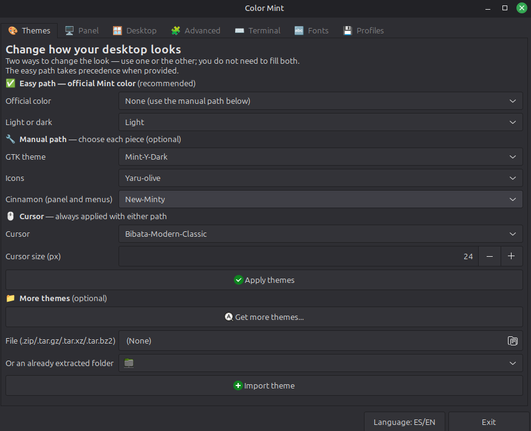
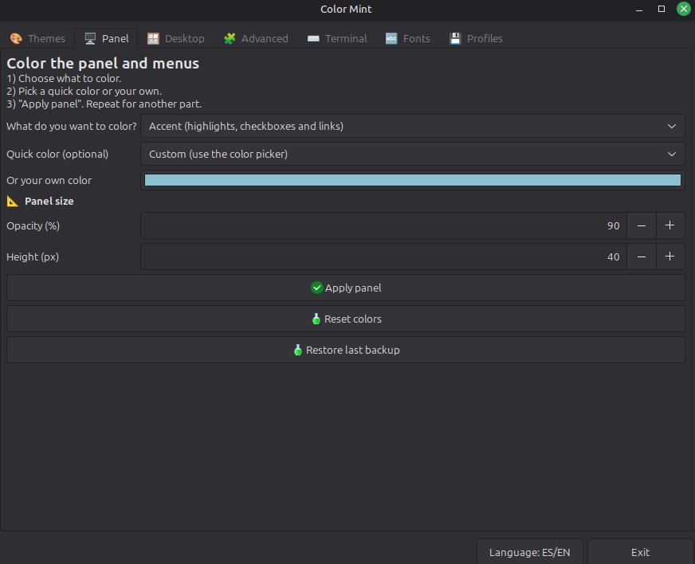
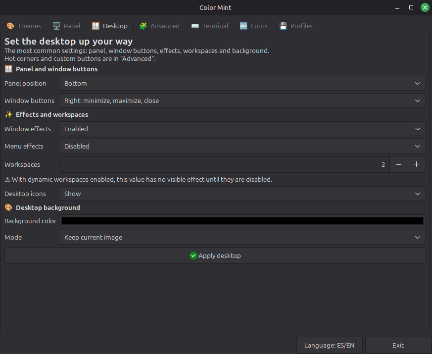
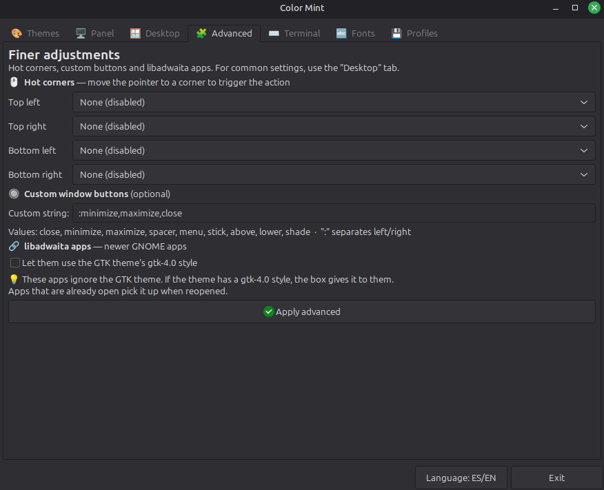
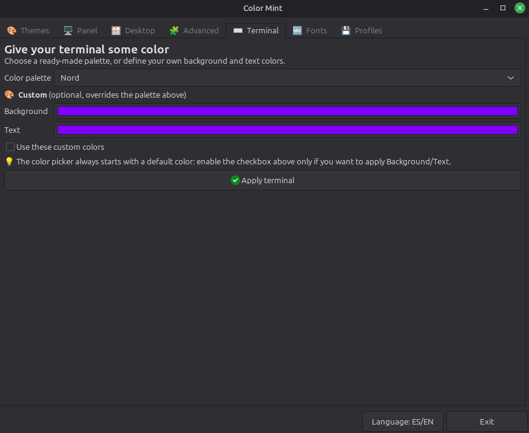
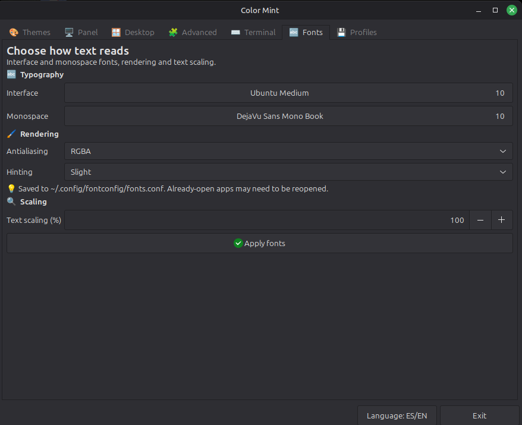
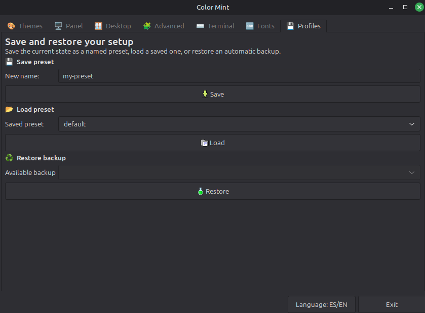

<p align="center">
  
</p>

# Color Mint

[Español](README.es.md)

 [](https://www.gnu.org/software/bash/) [](https://linuxmint.com/) [](LICENSE.txt)

Advanced visual customization for Linux Mint Cinnamon in a single window: themes, panel, desktop, terminal and fonts — with an automatic backup before every Apply in the window.

> **Language:** Color Mint includes its full interface in English and Spanish. It detects the system locale automatically (Spanish when applicable, English otherwise), and you can switch instantly with the **Language: ES/EN** button or with `./color-mint.sh l`.

## What's new in 3.1.0

- **Install and uninstall without leaving a trace.** `./color-mint.sh install` adds Color Mint to the applications menu (a copy in `~/.local/bin/color-mint` and a launcher with its icon; no `sudo`). `uninstall` removes only what Color Mint can show to be its own, and `--restore-look` also puts back the look your desktop had before Color Mint's first change. See [Uninstall](#uninstall).
- **More themes without leaving the window.** The **Get more themes...** button and `theme fetch <name>` download a theme from [Cinnamon Spices](https://cinnamon-spices.linuxmint.com) (HTTPS only, size-capped, never overwriting a theme you already have). `theme list-packages` and `theme install <package>` offer a short, verified list of theme packages (Arc, Materia, Papirus, Bibata...).
- **libadwaita apps in your theme's style.** libadwaita apps (the newer GNOME apps) ignore the GTK theme. `theme libadwaita on` and the box in the **Advanced** tab make them use the `gtk-4.0` style of your GTK theme, in its light or dark variant to match the light/dark scheme, and Color Mint keeps it in step when you change the theme or the scheme or load a look. Your accent still wins over the theme's wherever the theme takes its colors by name; what a theme paints with fixed colors, as Materia and Mint-Y do with their buttons, stays the theme's. `theme libadwaita off` takes the style away. Apps that are already open pick it up when reopened; a theme that bundles its `gtk-4.0` style inside itself, as Yaru does, cannot be imported and is refused with the reason.
- **Twenty ready-made looks, and presets you can share.** With the official Mint packages installed, Color Mint creates a light and a dark look for every Mint-Y color. `preset export` and `preset import` pass a preset around as a plain file, and presets now remember the light/dark scheme.
- **A preset is data, never code.** Presets used to be executed as shell. Now they are read as plain text, only known keys are accepted, and the whole preset is checked before a single setting is applied: a missing theme or a bad value changes nothing, and every problem is listed.
- **Safer theme imports.** Archives are checked before they are unpacked (path traversal, links, special files) and again afterwards. One that unpacks to more than 512 MB or holds more than 20,000 files is refused. Theme and font names with paths or control characters are rejected.
- **Atomic writes.** Every file Color Mint writes is replaced atomically, so an interrupted write cannot leave a half-written file; backups and imported themes appear in one step or not at all. Two Color Mint processes never write at the same time.
- **It only applies what exists.** The theme setters (GTK, icons, cursor, Cinnamon) now refuse a name that is not installed, instead of reporting "applied" and leaving the desktop on its default look. Themes installed in `~/.local/share` or `/usr/local/share` are found too, not only those in `~/.themes`, `~/.icons` and `/usr/share`.
- **A more comfortable window.** It fits a 1366×768 screen (the forms scroll), starts with any locale (with `LANG=C` it used to exit without showing anything), picks the most readable text color over your accent, follows the system GTK theme, and no longer leaves stray processes behind when you switch language or reload the window.
- **Other Cinnamon distributions.** With `dnf`, `pacman` or `zypper`, a missing dependency now comes with the exact command to run (with `apt`, Color Mint still offers to install it); the graphical interface refuses to start on a desktop that is not Cinnamon; and the window works the same with yad 0.40 and 14.1. An optional workflow checks Debian 13, Fedora and Arch. See [Compatibility](#compatibility).
- **A new icon, and quieter `--help` and `--version`.** The icon is bundled inside the script, so a copy of the script on its own keeps it. `--version` prints `Color Mint 3.1.0`, and neither it nor `--help` (now within 80 columns in both languages) creates folders or writes any state.
- **Tested.** The repository has a test suite (`bash tests/run.sh`, 14 suites that never touch your desktop) and a quality workflow: ShellCheck 0.11.0 pinned by version and checksum, a real render of the window under Xvfb and a 13-metric aesthetic scorecard. See [Tests](#tests).

## Screenshots















## What it is

Cinnamon spreads its appearance settings across the Settings panel, `dconf-editor` and individual `gsettings` commands — and some things are not there at all: the panel accent color, terminal color palettes, or an accent for your GTK3 and libadwaita apps. On top of that, the keys you need live under unintuitive schemas (`org.cinnamon.desktop.interface` for most settings, but `org.gnome.desktop.interface` for the monospace font, for example) that you either have to know by heart or guess.

Color Mint brings all of that — themes, panel, desktop, terminal and fonts — into one window, or one command line if you prefer the terminal. It already knows which schema belongs to each setting, and the window creates a backup before each Apply.

Under the hood it is a single Bash script. It reads and writes settings with `gsettings`, `dconf` and `gdbus`, draws its window with `yad`, and edits a handful of files in your home folder (the accent in `gtk.css`, font rendering in `fonts.conf`...) only when you use the matching command. There is no background service or daemon.

Seven blocks, both in the graphical interface and from the terminal:

- **🎨 Themes** — GTK theme, icons, cursor (with its size) and Cinnamon theme. A quick path with the official Mint-Y colors, or piece by piece if you prefer mixing third-party themes. It also imports downloaded themes in `.zip`, `.tar.gz`, `.tar.xz` or `.tar.bz2`, ready to apply, and, from the **Get more themes...** button or from the terminal, it can fetch a Cinnamon Spices theme by its name or install a package from a short, verified list of theme packages.
- **🖥️ Panel** — accent color, panel background and text, menu background and text, tooltip background and text, opacity and height. It includes a GTK accent that reaches GTK3 and libadwaita apps opened afterwards, not just the panel.
- **🪟 Desktop** — panel position, window buttons (7 presets or a custom string), effects when opening/closing windows and menus, number of workspaces, desktop icons and background color.
- **🧩 Advanced** — the four hot corners, custom window-button strings and a box that lets libadwaita apps use your GTK theme's `gtk-4.0` style, kept separate from Desktop so the main tab is not overloaded with fields.
- **⌨️ Terminal** — nine ready-made color palettes for the default gnome-terminal profile, or custom background/text colors.
- **🔤 Fonts** — interface font, monospace font, antialiasing + hinting and text scaling.
- **💾 Profiles** — save the current state as a named preset, load a saved one (two samples and, with the official Mint packages, twenty looks are included), or restore any earlier backup.

Every action also has a terminal command equivalent — the full reference is in [Commands](#commands).

## Advantages

- **One window, the right schema every time.** Changing the panel accent, applying a palette to the terminal, or carrying an accent over to your GTK3 and libadwaita apps normally means opening `dconf-editor`, guessing the right schema (which changes depending on the setting, as explained above) and, for the accent, editing the active theme CSS by hand. Color Mint already knows all of that — the technical comments at the top of the script document, schema by schema, how each one was worked out, in case you ever want to touch something that falls outside its scope.
- **Every Apply in the window can be undone.** Before each Apply button changes anything, the window creates a backup automatically, so you can try things without worrying about leaving the desktop worse than it was: if something does not look right, the Profiles tab restores it in one click. The terminal commands do not make a backup on their own; run `backup create` first. What a backup covers, and what restoring removes, is explained under [Backups and presets](#-backups-and-presets).
- **An accent on any Cinnamon theme.** The accent color is not limited to the official Mint-Y package: it works on any Cinnamon theme you have installed, detecting its dominant color and replacing it with the one you choose.
- **An accent beyond the panel.** The same accent can also be set for GTK3 and libadwaita apps (GTK4 apps in the GNOME style), not just the panel. Only apps opened afterwards show it, and Flatpak and GTK2 apps are not expected to receive it by default.
- **A theme that reaches libadwaita apps.** libadwaita apps ignore the GTK theme you pick. Color Mint can make them load its `gtk-4.0` style and keeps that in step when the theme or the light/dark scheme changes, with your accent on top wherever the theme allows it.
- **Built on what the community already made.** There is no new theme format to learn: Color Mint uses the GTK, icon, cursor and Cinnamon themes you already have, imports downloaded ones, and fetches more from Cinnamon Spices or from a short list of verified packages.
- **Scriptable and shareable.** Every graphical action has a terminal command equivalent, so all of this can be automated. A saved preset is a plain-text file that can be versioned, copied to another machine or edited by hand, and Color Mint never executes it.
- **One self-contained script.** It is a single `.sh` file — it used to be split across `gui/`, `lib/` and `presets/` — with no runtime dependency beyond `yad`, and that is only needed for the graphical interface. The icon is the last block of the file (base64 inside comments, never executed), so a copy of the script on its own is complete.
- **Careful with your system.** It does not ask for `sudo` to do its job: it installs a package only when you agree to it (a missing dependency, or `theme install`), and it copies itself to your home folder only when you run `install`.
- **Uninstalls without a trace.** It removes what it can show to be its own, names what it leaves, and can put the desktop back exactly as it was before its first change. See [Uninstall](#uninstall).

## Compatibility

Color Mint needs a running **Cinnamon** session: it relies on the `org.cinnamon.*` dconf schemas. In any other desktop (GNOME, KDE, Xfce, MATE...) the graphical interface refuses to start and changes nothing. The command line does not check the desktop, so run it only inside Cinnamon.

| Environment | Status | Notes |
| --- | --- | --- |
| Linux Mint 22.3 Cinnamon | ✅ Tested | Tested on its Ubuntu 24.04 base with yad 0.40.0, including real GUI rendering and a real click on Apply. |
| Other Linux Mint 22.x versions and LMDE | 🟡 Expected | Same Cinnamon schemas and `apt` packages; not tested. |
| Other distributions with Cinnamon (Ubuntu Cinnamon, Debian, Fedora, Arch...) | 🟡 Expected, best effort | Only `apt` installs missing dependencies for you; with any other package manager, Color Mint shows the exact command to run. |
| Linux Mint 27 "Adrien" | ❔ Unverified | Not released yet (planned for Christmas 2026, based on Ubuntu 26.04). Its Cinnamon is expected to support both X11 and Wayland sessions; the parts that rely on X11 may need changes. |
| GNOME, KDE, Xfce, MATE and other desktops | ⛔ Not supported | The graphical interface refuses to start. |

- **Bash:** 4.4 or newer; tested on 4.4.20 and on 5.2, the version in Mint 22.3.
- **yad:** tested with 0.40.0 (Mint 22.x, Ubuntu 24.04) and with 14.1, the current fork; the window and the Apply buttons behave the same.
- **Privileges:** no `sudo` to use it. It is asked for only by `theme install` (through `apt`), and only after you agree.

Tools it uses:

| Tool | Purpose | Included by default in Mint 22.3? |
| --- | --- | --- |
| `dconf`, `gsettings`, `gdbus` | Read and write all settings | Yes |
| `yad` | Graphical interface | No — Color Mint offers to install it |
| `notify-send` | Desktop notification when applying changes | Yes (optional) |

## Installation

Clone and run; there is nothing to install to use it:

```bash
git clone https://github.com/filonux/Color-Mint.git
cd Color-Mint/script
chmod +x color-mint.sh
./color-mint.sh
```

It also works with `bash color-mint.sh`, without giving it execution permission first (the script adds it itself when it can), or by downloading only `script/color-mint.sh` and opening it with a double click from the file manager.

To keep it in the applications menu, even after deleting the clone, install it for your user:

```bash
./color-mint.sh install
```

It copies the script to `~/.local/bin/color-mint` and creates a launcher with its icon; it needs no `sudo` and never overwrites a file that is not its own. Once installed, `color-mint` also works from any terminal (open a new session if `~/.local/bin` was not in your `PATH`). To take everything back, see [Uninstall](#uninstall).

**Dependencies.** On a stock Mint 22.3 Cinnamon installation, `dconf`, `gsettings` and `gdbus` are already installed. The one thing that is usually missing is `yad` — needed only for the graphical interface; if it is not found, Color Mint tells you and offers to install it with `apt`, asking for your confirmation first. To install everything in advance:

```bash
sudo apt install yad dconf-cli libglib2.0-bin
```

If you are only going to use the terminal, you probably do not need to install anything.

Everything Color Mint creates or edits lives here:

| What | Where |
| --- | --- |
| Installed command (only after `install`) | `~/.local/bin/color-mint` |
| Application launcher (only after `install`) | `~/.local/share/applications/color-mint.desktop` |
| Backups, presets, logs, its state, its icon, the look your desktop had before its first change and the record of what it installed | `~/.local/share/color-mint/` |
| Themes and icons you import or download | `~/.themes/` and `~/.icons/`, like any other theme |
| Files it edits when you use the matching command | `~/.config/gtk-3.0/gtk.css` and `~/.config/gtk-4.0/gtk.css` (global GTK accent), `~/.config/fontconfig/fonts.conf` (font rendering), `~/.Xresources` and `~/.config/environment.d/60-color-mint-cursor.conf` (cursor) |

In `gtk.css` and `.Xresources` it only touches its own marked block; the rest of the file is yours.

## Commands

General syntax: `./color-mint.sh <category> <action> [arguments]`. Colors always use `#RRGGBB` format.

> The values `claro`, `oscuro`, `mantener` and `solo_color` shown below are literal command arguments. They are kept unchanged because they are part of the script's CLI; only the surrounding descriptions are translated.

### General

| Command | What it does |
| --- | --- |
| `./color-mint.sh` / `./color-mint.sh gui` | Opens the graphical interface |
| `./color-mint.sh l` | Switches between Spanish and English and saves the choice |
| `./color-mint.sh --help` (or `-h`) | Prints the full reference, grouped like this section |
| `./color-mint.sh --version` | Prints `Color Mint 3.1.0` |

### 🎨 Themes

| Command | What it does |
| --- | --- |
| `theme mint-y-color <color> <claro\|oscuro>` | Quick path: applies an official Mint-Y package color |
| `theme gtk <name>` | GTK theme |
| `theme icon <name>` | Icon theme |
| `theme cursor <name>` | Cursor theme |
| `theme cursor-size <16-96>` | Cursor size, in pixels |
| `theme cinnamon <name>` | Cinnamon theme (panel and menus) |
| `theme libadwaita <on\|off\|status>` | libadwaita apps use the `gtk-4.0` style of the active GTK theme (`on`), stop using it (`off`) or show the file they import (`status`). It follows the light/dark scheme and any GTK theme change Color Mint makes, and the global GTK accent stays on top of whatever the theme takes by name (a theme that paints with fixed colors, as Materia and Mint-Y do with their buttons, keeps them). A theme with no `gtk-4.0/gtk.css`, or one that bundles its style as a resource (Yaru), is refused |
| `theme import <file\|folder>` | Installs a downloaded theme (`.zip`, `.tar.gz`, `.tar.xz`, `.tar.bz2`); an archive that unpacks to more than 512 MB or holds more than 20,000 files is refused |
| `theme fetch <name>` | Downloads a theme from [Cinnamon Spices](https://cinnamon-spices.linuxmint.com) by its UUID, the name shown on its page (HTTPS only, size-capped) and installs it like `theme import`; it never overwrites an installed theme |
| `theme list-packages` | Lists the short, verified list of theme packages (apt) and marks the ones already installed |
| `theme install <package>` | Installs one package of that list with `sudo apt-get` (apt asks before installing); anything outside the list is refused |
| `theme folder` | Opens the themes folder |
| `theme list-gtk` / `list-icon` / `list-cursor` / `list-cinnamon` | Lists installed themes of each type |
| `theme list-mint-y-colors <claro\|oscuro>` | Lists the available official Mint-Y colors |

### 🖥️ Panel

| Command | What it does |
| --- | --- |
| `panel accent <#RRGGBB>` | Panel accent color |
| `panel bg <#RRGGBB>` | Panel background |
| `panel fg <#RRGGBB>` | Panel text |
| `panel menu-bg <#RRGGBB>` | Menu background |
| `panel menu-fg <#RRGGBB>` | Menu text |
| `panel tooltip-bg <#RRGGBB>` | Tooltip background |
| `panel tooltip-fg <#RRGGBB>` | Tooltip text |
| `panel gtk-accent <#RRGGBB>` | The same accent for GTK3 and libadwaita apps opened afterwards |
| `panel opacity <0-100>` | Panel opacity, in % |
| `panel height <16-100>` | Panel height, in pixels |
| `panel reset-colors` | Removes panel color customization (and the global GTK accent, if any) |

### 🪟 Desktop and 🧩 Advanced

| Command | What it does |
| --- | --- |
| `desktop panel-position <top\|bottom>` | Panel at the top or bottom |
| `desktop window-buttons <preset\|string>` | Window buttons — see presets below, or use a custom string (for example `close,minimize:maximize`) |
| `desktop list-button-presets` | Lists the button presets with their real string |
| `desktop hotcorners <tl> <tr> <bl> <br>` | Hot corner action for each corner: `none`, `expo`, `scale` or `desktop` |
| `desktop effects <on\|off>` | Effects when opening/closing windows |
| `desktop menu-effects <on\|off>` | Effects when opening menus |
| `desktop workspaces <1-20>` | Number of workspaces |
| `desktop icons <show\|hide>` | Desktop icons |
| `desktop bg-color <#RRGGBB> <mantener\|solo_color>` | Background color: `mantener` puts it behind your wallpaper, which stays (and is shown again if `solo_color` had hidden it); `solo_color` hides the wallpaper and shows only the color. The wallpaper is never deleted or replaced |

`window-buttons` presets: `derecha`, `izquierda`, `gnome`, `mac-clasico`, `compacto`, `menu-izquierda`, `solo-cerrar-izquierda`.

Hot corners and the custom window-button string have their own **Advanced** tab, separate from **Desktop** — on the terminal they are the same `desktop` commands shown above. The same tab holds the libadwaita box, which on the terminal is `theme libadwaita on` or `off`.

### ⌨️ Terminal

| Command | What it does |
| --- | --- |
| `terminal apply_palette <name>` | Applies a ready-made color palette |
| `terminal list` | Lists the available palettes |
| `terminal custom-colors <#background> <#text>` | Custom colors (either one can be empty: `""`) |

Included palettes: `nord`, `dracula`, `gruvbox`, `solarized-dark`, `solarized-light`, `monokai`, `one-dark`, `tokyo-night`, `catppuccin-mocha`.

### 🔤 Fonts

| Command | What it does |
| --- | --- |
| `fonts font <name>` | Interface font |
| `fonts monospace <name>` | Monospace font (terminal, editors) |
| `fonts rendering <rgba\|grayscale\|none> <slight\|medium\|full\|none>` | Antialiasing and hinting |
| `fonts scaling <50-200>` | Text scaling, in % |

### 💾 Backups and presets

| Command | What it does |
| --- | --- |
| `backup create` | Creates a backup now |
| `backup list` | Lists backups |
| `backup restore <name>` | Restores a backup |
| `preset save <name>` | Saves the current state as a preset |
| `preset list` | Lists saved presets |
| `preset load <name>` | Applies a saved preset |
| `preset export <name> <file\|folder>` | Copies a saved preset to a file (or into a folder); it never overwrites |
| `preset import <file> [name]` | Stores a preset someone shared, after checking it; it does not apply it, and it tells you which themes you still need |

**What a backup covers.** The Apply buttons in the window make a backup before they change anything. The terminal commands do not, so run `backup create` first when you want a way back. A backup holds the dconf settings Color Mint changes (Cinnamon, the GNOME interface, GNOME Terminal, Nemo and the XApp portal), `~/.themes`, `~/.config/gtk-3.0` and `~/.config/fontconfig/fonts.conf`. For `~/.Xresources`, `~/.config/gtk-4.0/gtk.css` and the cursor file in `~/.config/environment.d/` it notes whether they existed and keeps Color Mint's block in the first two and the whole cursor file. It does not hold `~/.icons`. A backup made before this was recorded restores only what it does hold.

**Restoring replaces; it does not merge.** `~/.themes` and `~/.config/gtk-3.0` go back to exactly what they held when the backup was made, so a theme you imported and any `gtk-3.0` setting you added afterwards are deleted. In `~/.Xresources` and `gtk-4.0/gtk.css` only Color Mint's own block goes back and your other lines stay, including those you added afterwards; a file that did not exist then and now holds only that block is removed, and so are the cursor file and a `fonts.conf` created afterwards if they still look like Color Mint's. A file that is a link is written where it leads and the link stays; a link that cannot be written, or a Color Mint block with no closing marker, stops the restore before anything changes and names the file. The window asks for confirmation and says so; `backup restore` in the terminal does not ask. A restore does not make a backup of its own, so run `backup create` before it if you may want to come back.

Two sample presets are included: `default` (the light Mint-Y look with the icons and cursor Mint ships, plus its own accent, panel and terminal palette) and `nord-dark` (a cool look inspired by the Nord palette). If the official Mint packages `mint-themes`, `mint-y-icons` and `mint-cursor-themes` are installed, Color Mint also creates twenty looks, each one once: a light and a dark look for every Mint-Y color (`mint-green`, `mint-green-dark`, `mint-aqua`, `mint-aqua-dark` and so on up to `mint-teal-dark`). A look sets only the GTK, Cinnamon, icon and cursor themes and the light/dark scheme. A look you delete is not created again, and one you edit is never overwritten.

### 📦 Install and uninstall

| Command | What it does |
| --- | --- |
| `install` | Adds Color Mint to the applications menu: copies the script to `~/.local/bin/color-mint` and creates a launcher with its icon. It needs no `sudo`, can be repeated and never overwrites a file that is not its own |
| `uninstall [--restore-look] [--keep-config] [--yes]` | Removes the launcher and the copy. It shows what it is going to do and asks first (`--yes` skips the question). `--restore-look` also puts back the look the desktop had before Color Mint's first change; `--keep-config` keeps presets, backups and settings |

## A five-minute tour

Each tab is applied independently with its own Apply button: there is no final Save button. Each tab applies its own changes immediately, and creates its own backup just before doing so. When it finishes, a desktop notification and a dialog show what was actually applied, marking any failed item with ⚠ instead of hiding the error.

1. **Open it.** Run `./color-mint.sh` (or pick **Color Mint** in the applications menu if you ran `install`). If `yad` is missing, Color Mint tells you and offers to install it.
2. **Start with the easy path.** In the **Themes** tab, under "Easy path — official Mint color", choose an **Official color** and **Light or dark**, then click **Apply themes**.
3. **Color the panel.** In the **Panel** tab, choose what to color, pick a quick color or your own `#RRGGBB`, and click **Apply panel**. Repeat for another part.
4. **Give the terminal a palette.** In the **Terminal** tab, choose one of the nine palettes and click **Apply terminal**.
5. **Save it.** In the **Profiles** tab, type a name under **Save preset** (for example `my-preset`) and click **Save**. Later, pick it under **Load preset** and click **Load**.
6. **Go back if you do not like it.** Still in **Profiles**, pick a backup under **Restore backup** and click **Restore**. Each restore asks for confirmation first, and warns that themes added after that backup will be deleted.

Most changes are visible immediately: Color Mint restarts the Cinnamon process (not the session) after each application. The exception is cursor size, which sometimes does not refresh live — this is a known `cinnamon-settings-daemon` limitation, not a script bug; logging out and back in always applies it.

The same tour from the terminal, one command per setting and without opening any window — useful for automation or for reproducing the same configuration on several machines. The terminal commands do not make a backup, so the first line does:

```bash
./color-mint.sh backup create
./color-mint.sh theme mint-y-color Blue oscuro
./color-mint.sh panel accent "#88C0D0"
./color-mint.sh terminal apply_palette nord
./color-mint.sh preset save my-setup
```

## Advanced configuration

**Where it keeps its data.** Color Mint keeps what it needs in `~/.local/share/color-mint/`: `backups/`, `presets/`, `logs/`, `original/` (the look your desktop had before Color Mint's first change), `state.conf` (your language), `installed.txt` (what it installed, so `uninstall` knows what is its own) and its icon. Set `CM_HOME` to keep that folder somewhere else, for example for a trial run:

```bash
CM_HOME=/tmp/color-mint-trial ./color-mint.sh preset list
```

`CM_HOME` moves only Color Mint's own data. The desktop settings and the files in your home folder that it edits are still the real ones.

**Presets are plain text.** A preset is a file in `presets/` with one `KEY="value"` per line and `#` comments. This is what `default` looks like:

```bash
# Preset "default" - the light Mint-Y look with the icons and cursor Mint ships
# Edit these values by hand and load the preset from the Profiles tab
GTK_THEME="Mint-Y"
ICON_THEME="Mint-Y"
CURSOR_THEME="Bibata-Modern-Classic"
CURSOR_SIZE="24"
CINNAMON_THEME="Mint-Y"
COLOR_SCHEME="prefer-light"
FONT_NAME="Noto Sans 10"
TEXT_SCALING="100"
ACCENT_COLOR="#56B6C2"
PANEL_OPACITY="100"
PANEL_HEIGHT="40"
TERMINAL_PALETTE="nord"
PANEL_POSITION="bottom"
WINDOW_BUTTONS="derecha"
HOTCORNER_TL="none"
HOTCORNER_TR="none"
HOTCORNER_BL="none"
HOTCORNER_BR="none"
```

Only these keys are accepted, and each value is checked like the command that sets it:

- Themes: `GTK_THEME`, `ICON_THEME`, `CURSOR_THEME`, `CURSOR_SIZE`, `CINNAMON_THEME`, `COLOR_SCHEME`
- Fonts: `FONT_NAME`, `MONOSPACE_FONT`, `FONT_ANTIALIAS`, `FONT_HINTING`, `TEXT_SCALING`
- Panel: `ACCENT_COLOR`, `PANEL_BG_COLOR`, `PANEL_FG_COLOR`, `MENU_BG_COLOR`, `MENU_FG_COLOR`, `TOOLTIP_BG_COLOR`, `TOOLTIP_FG_COLOR`, `GTK_ACCENT_COLOR`, `PANEL_OPACITY`, `PANEL_HEIGHT`
- Terminal: `TERMINAL_PALETTE`
- Desktop: `PANEL_POSITION`, `WINDOW_BUTTONS`, `HOTCORNER_TL`, `HOTCORNER_TR`, `HOTCORNER_BL`, `HOTCORNER_BR`, `WORKSPACES`, `DESKTOP_EFFECTS`, `MENU_EFFECTS`, `DESKTOP_ICONS`, `DESKTOP_BG_COLOR`

A preset is never executed: an unknown key, shell syntax or a control character gets the whole file refused, and a theme that is not installed is reported before anything is applied. Share one with `preset export` and bring one in with `preset import`.

**Built-in limits.** They are not settings, they are part of how Color Mint stays safe:

- `theme import` and `theme fetch` refuse an archive that unpacks to more than 512 MB or holds more than 20,000 files, and they check it again after unpacking.
- `theme fetch` talks HTTPS only, downloads at most 32 MB and gives up after 120 seconds.
- `theme install` accepts only the packages in `theme list-packages`.

## Uninstall

```bash
./color-mint.sh uninstall
```

Run it as `color-mint uninstall` if you installed it. It shows what it is going to do and asks first (`--yes` skips the question). Its options choose what happens to your desktop and to Color Mint's own data:

| Command | Launcher and copy | Presets, backups, logs and settings | Your desktop |
| --- | --- | --- | --- |
| `uninstall` | Removed | Removed | Keeps the look it has now |
| `uninstall --keep-config` | Removed | Kept | Keeps the look it has now |
| `uninstall --restore-look` | Removed | Removed | Goes back to the look from before Color Mint |
| `uninstall --restore-look --keep-config` | Removed | Kept (the saved original look and the install record are deleted) | Goes back to the look from before Color Mint |

Color Mint saves the original look once, right before the first command that changes it. `--restore-look` puts it back — desktop settings, the files Color Mint edited, and the themes and icons it imported — and asks you to log out and back in so the cursor and the fonts finish changing. If Color Mint had already been used before it could save that look, the plan warns that it may not be the factory one.

Only what Color Mint can show to be its own is deleted: a file you edited, a launcher or a copy that is not Color Mint's, or an unknown file in its folder is left in place and named. Packages installed with `apt` are never removed for you; the command to remove them is shown. If `uninstall` is interrupted, run it again to finish.

## Plays well with Scriptya

[Scriptya](https://github.com/filonux/Scriptya) is another Filonux project: it turns any script into a standalone app with its own icon, integrated into the Cinnamon menu and/or desktop, and also lets you launch, update or uninstall it from a single menu.

Scriptya reads optional metadata at the top of a script, and `color-mint.sh` carries it (`# MENU:`, `# DESCRIPTION:`, `# CONFIRM:`, `# TERMINAL:`, `# SUDO:` and `# ICON:`), so Scriptya can show Color Mint with its name and icon without further setup. `install` does the same job for Color Mint alone, with no other program involved; use whichever you prefer.

## Language and roadmap

Color Mint is fully available in English and Spanish: graphical interface, help, messages and visible selector labels.

On first launch, it detects the language of system messages using the normal `LC_ALL` → `LC_MESSAGES` → `LANG` precedence: if the locale is Spanish, it starts in Spanish; otherwise, the default is English. The choice is saved for subsequent launches.

From the terminal, a single letter switches from `es` to `en` or from `en` to `es`:

```bash
./color-mint.sh l
```

In the graphical interface, the **Language: ES/EN** button does exactly the same thing and reloads all seven tabs without changing any internal key or technical value used by the program.

**Mini-roadmap**, subject to real interest:

- [x] Translate the interface into English — it is now available in both Spanish and English.
- [x] Install and uninstall without leaving a trace (3.1.0).
- [x] More themes from Cinnamon Spices and from a short list of verified packages (3.1.0).
- [x] Show the accent and the theme in libadwaita apps, with a light/dark scheme that follows the look and community GTK4 themes that keep the accent (3.1.0).
- [ ] Reach Flatpak apps with the accent and the theme.
- [ ] Easier first steps: a preview before applying, a tab for looks, a first-run guide and a simple/advanced mode.
- [ ] Check Linux Mint 27 once it is released.

If you are interested in an improvement, open an issue and say so — it is the simplest way to show that people are waiting for it.

## Tests

The project includes a regression suite of 14 suites. From the project root, run all of them:

```bash
bash tests/run.sh
```

Or only some:

```bash
bash tests/run.sh test_security.sh            # one suite
bash tests/run.sh --skip lint.sh              # everything except ShellCheck
bash tests/run.sh --skip test_gui_render.sh   # without Xvfb and yad
```

`bash tests/run.sh --help` lists the suites. The exit status is 0 when everything passes, 1 when a suite fails and 2 when a suite could not run because a tool is missing.

Each suite runs with its own `HOME`, XDG folders and `TMPDIR` in a clean environment, and the tools that would touch your system (`gsettings`, `dconf`, `gdbus`, `curl`, `sudo`, `apt-get`...) are doubles that record how they were called. Running the tests never changes the desktop or the configuration of the machine that runs them. The one suite that needs the real thing, `test_gui_render.sh`, draws the real window with `yad`, and a real GTK 4 window with libadwaita, on a virtual X server.

The suites cover: repository layout and hygiene; an aesthetic scorecard of 13 metrics with a recorded baseline; security (input validation, theme archives, presets as data); robustness and failure paths; atomic writes, locks and backups; the install/uninstall cycle, which must leave no trace; the bilingual layer and the GUI wiring; theme discovery against a fake themes tree; presets, looks, export and import; `theme fetch` and `theme install`; the real render of the window, with a real click on Apply, and of what GTK 4 and libadwaita paint from the CSS Color Mint writes; and static analysis with ShellCheck.

Besides Bash, the tests use ShellCheck 0.11.0 (`lint.sh`), `yad`, `xvfb`, `x11-utils` and `xdotool` (render and click), `python3-gi`, `gir1.2-gtk-4.0` and `gir1.2-adw-1` (GTK 4 and libadwaita), ImageMagick with `fonts-dejavu-core`, `zip`, `unzip`, `xz-utils` and `bzip2`. `CM_REQUIRE_GUI_RENDER=1` turns a skipped render into a failure, and `CM_CHECK_SPICES=1 bash tests/run.sh test_catalog.sh` also measures the real Cinnamon Spices server.

On GitHub, the **Quality** workflow runs the static analysis and all the suites on every push and pull request, and keeps the GUI screenshots as an artifact for 14 days. A second workflow, `compat.yml`, runs the suites on Debian 13, Fedora and Arch when you start it by hand and on Mondays; it never blocks anything.

## Contributing

Issues and pull requests are welcome. There are templates for reporting bugs, proposing improvements and sending pull requests, and the full guide is in [.github/CONTRIBUTING.md](.github/CONTRIBUTING.md). This project follows the code of conduct described in [.github/CODE_OF_CONDUCT.md](.github/CODE_OF_CONDUCT.md); for private security reports, see [.github/SECURITY.md](.github/SECURITY.md).

## License

GPLv3. See [LICENSE.txt](LICENSE.txt).
Copyright © 2026 Filonux.

---

Made by **[Filonux](https://github.com/filonux)**.
